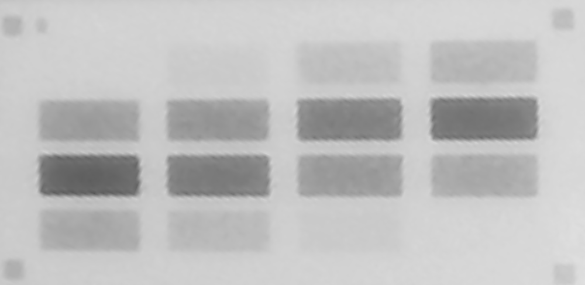

# Fast-refresh 8-level grayscale e-paper

[简体中文](README.md)

An ESP32-S3 and a 250×122 Waveshare monochrome panel driven as an SSD1680 produce eight physical gray levels with short FR7 pulses. The player submits a new frame every 40 ms. Pixels can finish a transition over several frames. If a target changes, the scheduler cancels the remaining pulses and estimates the next drive from the pulses already sent.



## Measurements

- G0 through G7 run from white to black. All 56 directed transitions passed the paired optical comparison after swapping test and reference positions. Samples were taken about 0.2 seconds and 1 second after the last scan. [Gray-card data](data/gray-card-fr7.json) · [Route table](data/routes-fr7.csv) · [Measurement log](data/transition-measurements.json)
- The board accepted all 2,184 frames of an 87.36-second clip at a 25 FPS content submission rate. The serial log records frame submission, scans, and CRC. [Playback timing](data/playback-timing.json)
- In a 16-tile reversal test, pulses delivered to an obsolete target fell from 1,752 to zero. The verified G0-to-G7 route takes 13 scans, so a large transition can span several frames. [Scheduler comparison](data/frame-first.json)

The measurements are for one panel and its bench configuration. The 25 FPS figure describes content submission. Optical settling depends on the transition and previous drive history. Long-term panel life at this refresh rate has not been measured. The standalone driver in this repository also passed the 125-frame original animation and gray-card runs on the same panel. [Release hardware log](data/release-smoke.log)

## Run

Use an ESP32-S3 with OPI PSRAM, USB Serial/JTAG, and Arduino-ESP32 3.3.12, together with Python 3.11 or newer. The example configuration uses 16 MB flash and 8 MB PSRAM. Power the panel according to the specifications of your module or adapter.

| Panel signal | ESP32-S3 |
| --- | --- |
| BUSY | GPIO7 |
| RST | GPIO8 |
| DC | GPIO9 |
| CS | GPIO10 |
| MOSI | GPIO11 |
| SCK | GPIO12 |

Run these commands from the repository root. Substitute your serial port for `COM10`, such as `/dev/ttyACM0` on Linux. The upload command writes the new firmware to the board.

```sh
arduino-cli core install esp32:esp32@3.3.12 --additional-urls https://espressif.github.io/arduino-esp32/package_esp32_index.json
arduino-cli compile --upload --port COM10 --fqbn "esp32:esp32:esp32s3:USBMode=hwcdc,CDCOnBoot=cdc,FlashSize=16M,PartitionScheme=huge_app,PSRAM=opi" firmware/VideoPlayer
python -m pip install -r requirements.txt
python tools/play.py card --port COM10
python tools/play.py transition --from 2 --to 5 --port COM10
python tools/play.py motion --port COM10
```

The transition test places the starting gray on the left and the target reference on the right, then updates only the left patch. In the measured recipes, `W` darkens, `B` lightens, and `H` holds. To play your own source footage, install FFmpeg.

```sh
python tools/play.py video --input my-clip.mp4 --port COM10
```

For another panel, reuse the calibration workflow and scheduler and validate the panel driver, gray card, and transition table for that hardware. See [third-party notices](THIRD_PARTY_NOTICES.md) for driver references, project lineage, and dependencies. Project code is licensed under [MIT](LICENSE).
