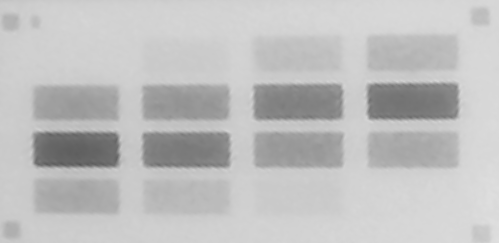

# 可以实现快刷的8灰度墨水屏

[English](README.en.md)

在 ESP32-S3 和一块按 SSD1680 驱动的 250×122 黑白微雪屏上，用 FR7 短脉冲做出八阶实体灰度。刷新时每 40 ms 接收一帧，像素可以跨帧完成换色。目标变化时，调度器取消旧目标的剩余脉冲，并根据已经发出的驱动重新估算位置。



## 实测结果

- G0～G7 从白到黑分为八档。一个灰阶到另一个灰阶的 56 条有向路径，在同屏换位复测中全部通过。采样在末次扫描后约 0.2 秒和 1 秒。 [灰卡数据](data/gray-card-fr7.json) · [转换表](data/routes-fr7.csv) · [测量记录](data/transition-measurements.json)
- 87.36 秒视频在板上完整提交 2184 帧，内容提交率为 25 FPS。视频测试的串口日志记录了帧提交、扫描和 CRC。 [视频时序](data/playback-timing.json)
- 16 区块的连续反向对照中，旧目标在改向后仍发出的区块脉冲从 1752 次降为 0 次。G0→G7 的通过版配方需要 13 次扫描，大跨度换色会跨帧。 [调度对照](data/frame-first.json)

以上数据来自一块屏和对应的实验配置。25 FPS 表示内容提交频率。像素亮度到位时间随灰阶跨度和历史变化。高刷长期使用寿命尚未测量。仓库里的独立驱动也在同一块屏上通过了 125 帧自制动画和灰卡测试。 [发布版实机日志](data/release-smoke.log)

## 运行

使用 ESP32-S3、OPI PSRAM、USB Serial/JTAG、Arduino-ESP32 3.3.12 和 Python 3.11 或更新版本。示例板配置是 16 MB Flash、8 MB PSRAM。微雪屏的供电使用你所用的屏幕模块或转接板规格。

| 屏幕信号 | ESP32-S3 |
| --- | --- |
| BUSY | GPIO7 |
| RST | GPIO8 |
| DC | GPIO9 |
| CS | GPIO10 |
| MOSI | GPIO11 |
| SCK | GPIO12 |

在仓库根目录运行，将 `COM10` 换成你的串口。Linux 常见的是 `/dev/ttyACM0`。下面的上传命令会写入板端固件。

```sh
arduino-cli core install esp32:esp32@3.3.12 --additional-urls https://espressif.github.io/arduino-esp32/package_esp32_index.json
arduino-cli compile --upload --port COM10 --fqbn "esp32:esp32:esp32s3:USBMode=hwcdc,CDCOnBoot=cdc,FlashSize=16M,PartitionScheme=huge_app,PSRAM=opi" firmware/VideoPlayer
python -m pip install -r requirements.txt
python tools/play.py card --port COM10
python tools/play.py transition --from 2 --to 5 --port COM10
python tools/play.py motion --port COM10
```

转色测试先生成左侧起始灰和右侧目标灰，随后只更新左侧。原始配方中 `W` 为压暗、`B` 为提亮、`H` 为保持。播放自己的视频时，在系统中安装 FFmpeg。

```sh
python tools/play.py video --input my-clip.mp4 --port COM10
```

其他面板可以沿用校准流程和调度，需按面板重新适配和验证波形、八阶灰以及 56 条路径。面板驱动来源、实验参考和依赖见 [第三方说明](THIRD_PARTY_NOTICES.md)。项目代码使用 [MIT](LICENSE)。
